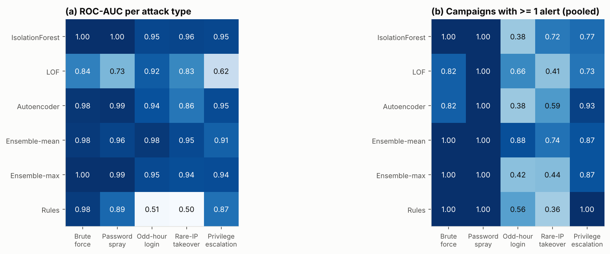

# Unsupervised Anomaly Detection on Authentication / Access Logs

A small, fully reproducible research project: detect suspicious activity
(brute force, password spraying, odd-hour logins, account takeover from rare
IPs, privilege escalation) in web-application access logs **without using
labels**, and evaluate the detectors against a hidden ground truth.

* **Code** – `src/` (generator, features, detectors, evaluation, plots) and a
  single entry point `run_pipeline.py`.
* **Results** – `results/` (metrics CSVs, `summary.md`, figures).
* **Paper** – `paper/paper.md` (Abstract → Conclusion, references).
* **Data** – `data/` (the reference dataset of seed 0; regenerated by the pipeline).

```bash
pip install -r requirements.txt
python run_pipeline.py            # full study: 5 seeds + ablation + sweeps (~9 min, 4 cores)
python run_pipeline.py --quick    # smoke test: 1 seed, no sweeps (~1 min)
```

Everything is seeded (data generation, model initialisation, subsampling), so
re-running produces the same tables and figures. Only `numpy`, `pandas`,
`scikit-learn` and `matplotlib` are used.

## Headline results

Test weeks, 2 % alert budget, mean ± std over 5 seeds (full tables in
[`results/summary.md`](results/summary.md), discussion in [`paper/paper.md`](paper/paper.md)):

| Method | ROC-AUC | Avg. precision | Precision | Recall | F1 | Campaigns with ≥ 1 alert |
|---|---|---|---|---|---|---|
| **Isolation Forest** | **0.978 ± 0.009** | **0.737 ± 0.102** | **0.775** | **0.594** | **0.655 ± 0.102** | 68.2 % |
| LOF (k = 35) | 0.810 ± 0.089 | 0.141 ± 0.068 | 0.209 | 0.184 | 0.192 ± 0.102 | 66.2 % |
| Autoencoder (MLP) | 0.945 ± 0.021 | 0.348 ± 0.104 | 0.387 | 0.323 | 0.344 ± 0.103 | 65.6 % |
| Ensemble-mean (rank) | 0.962 ± 0.014 | 0.488 ± 0.136 | 0.534 | 0.404 | 0.448 ± 0.124 | **87.0 %** |
| Ensemble-max (rank) | 0.969 ± 0.007 | 0.435 ± 0.097 | 0.541 | 0.466 | 0.487 ± 0.138 | 64.3 % |
| SIEM rules (baseline) | 0.773 ± 0.054 | 0.462 ± 0.133 | 0.592 | 0.551 | 0.570 ± 0.122 | 69.5 % |

* Isolation Forest detects **every** brute-force and password-spray campaign
  and is the best event-level detector, but those bursts fill its alert
  budget: odd-hour and rare-IP misuse of valid accounts is ranked highly
  (ROC-AUC ≈ 0.95) yet only 4 % / 17 % of those events are alerted.
* The rank-averaging ensemble spends the same budget more evenly and alerts
  on **87 % of all campaigns** (88 % of odd-hour logins vs. 38 % for IF).
* SIEM rules are precise on what they encode but blind to valid-account
  misuse (ROC-AUC ≈ 0.51 on odd-hour and rare-IP attacks).
* Time-of-day and 7-day familiarity features matter most (ablation); LOF
  suffers attack-specific masking whose direction flips with k.




---

## 1. Threat model

| | |
|---|---|
| **Asset** | A web application behind a password login (`POST /login`), with ordinary business endpoints and a privileged `/admin/*` area. |
| **Defender's view** | Only the access log, as a SIEM would ingest it: `timestamp, user, src_ip, method, endpoint, status`. No labels, no payloads, no threat-intel feeds, no geo-IP. |
| **Adversaries** | (1) *External, credential-less*: online password guessing against one account (brute force, MITRE ATT&CK T1110.001) or few passwords against many accounts (password spraying, T1110.003). (2) *External, with stolen credentials* (Valid Accounts, T1078): logs in successfully, either at an hour the owner never works or from an IP the owner never used, and harvests data (`/api/export`, `/files/download`). (3) *Insider*: a legitimate non-admin user probes `/admin/*` (HTTP 403s) and then abuses a misconfiguration to change roles (T1078 / T1068-style privilege escalation). |
| **Out of scope** | Attackers that perfectly mimic the victim's hours, IPs and endpoint mix; distributed (botnet) brute force from thousands of IPs; log tampering; network-layer attacks. |
| **Detection goal** | Rank events so that analysts reviewing a fixed alert budget (2 % of traffic) see as many attacker events — and as many distinct attack campaigns — as possible. |

## 2. Dataset (synthetic, documented)

Public authentication datasets exist (e.g. LANL's *Comprehensive, Multi-Source
Cyber-Security Events*), but they are large, require a registration form, have
very sparse red-team labels and are not HTTP access logs. For a self-contained
and reproducible study we generate logs with `src/generate.py`; every
behaviour below is a parameter in `src/config.py`.

**Organisation.** 180 human users (6 % administrators) and 12 service accounts,
simulated for 6 weeks (42 days) starting on a Monday.

**Normal behaviour.**
* Each human has personal working hours (start ≈ N(8.4 h, 0.9 h), length ≈ 8.5 h),
  a session rate, a weekend-activity probability, and a Dirichlet-distributed
  preferred mix of 9 business endpoints. Admins additionally use `/admin/*`.
* Source IPs: 6 shared office NAT addresses (`203.0.113.0/24`), a rotating
  20-address VPN pool (`198.51.100.0/24`) for 35 % of users, or a personal
  home IP. (Documentation ranges from RFC 5737 are used for corporate addresses.)
* Sessions: optional typo failures → successful login → log-normal number of
  page views with exponential think times → optional logout.
* Service accounts run scheduled jobs every 30–120 min, 24/7, from fixed
  internal IPs — so "night-time activity" alone is not suspicious.

**Benign confounders** (labelled *normal*, tagged in `labels.csv` for error analysis):
password typos (4 % of logins), forgotten-password streaks of 4–8 failures,
business travel (a never-seen IP for a whole day), legitimate late-night work,
and regular users occasionally clicking a stale admin link (one 403).

**Attack campaigns** (labelled *anomalous*; 92 per dataset):

| type | count | description |
|---|---|---|
| `brute_force` | 14 | one fresh external IP, one account (40 % admins), 30–150 failed logins at tool speed; 30 % succeed and browse briefly |
| `password_spray` | 12 | one external IP, 25–70 accounts (incl. non-existent names such as `admin`, `root`), 1–2 tries each, 20–90 s apart (low and slow) |
| `odd_hour_login` | 24 | stolen credentials used between 01:00 and 04:59, from the VPN pool or the victim's home IP; data-heavy session |
| `rare_ip_takeover` | 24 | stolen credentials used **during the victim's working hours** from a never-seen external IP; data-heavy session |
| `privilege_escalation` | 18 | non-admin insider from a usual IP: normal start, 5–25 `/admin/*` requests answered 403, then (60 %) `PUT /admin/roles` 200 and admin browsing |

Every event emitted by an attacker is labelled anomalous — including
ordinary-looking page views inside a hijacked session — which makes
event-level recall deliberately hard and honest. Per seed the dataset has
166–178 k events, ≈2.1 % of them anomalous.

Files (seed 0): `data/logs.csv.gz` (what the detectors see),
`data/labels.csv.gz` (hidden: `is_anomaly, attack_type, attack_id, benign_tag`),
`data/campaigns.csv` (one row per injected campaign).

## 3. Method

### Features (`src/features.py`) — 24 per event, all *causal*
Each event is described only by information available at its own timestamp,
so the detector could run online in a SIEM and nothing leaks from the future.

| group | features |
|---|---|
| event | `is_login`, `is_fail_login`, `is_forbidden` (403), `is_admin_ep`, `ep_rarity` (surprisal of the method+endpoint) |
| time | `hour_sin`, `hour_cos`, `is_weekend`, `user_hour_rarity` (smoothed surprisal of this hour ±1 h in the account's own history) |
| source-IP windows | `ip_events_1m` (request rate), `ip_fail_5m`, `ip_fail_ratio_1h`, `ip_users_30m` (distinct accounts) |
| account windows | `user_fail_10m`, `user_events_5m`, `user_forbidden_1h`, `user_ips_24h`, `user_gap_log` |
| 7-day profile | `ip_events_7d`, `ip_users_7d`, `user_events_7d`, `user_ip_share_7d`, `user_ip_age` (time since the user–IP pair was first seen, capped at 7 d), `user_ep_share_7d` |

Counts are `log1p`-compressed. Sliding-window sums are vectorised with a
single `searchsorted` over a composite (entity, time) key.

### Detectors (`src/models.py`)
* **Isolation Forest** (300 trees, ψ = 256).
* **Local Outlier Factor**, novelty mode, k = 35, standardised features.
* **Autoencoder**: scikit-learn `MLPRegressor` 24-24-8-24-24 trained to
  reconstruct its standardised input; score = mean squared reconstruction error.
* **Ensembles**: each detector's score → percentile rank on the calibration
  week; combined by **mean** (consensus) or **max** (any detector alarmed).
* **Rule baseline** (what a SOC already has): ≥ 10 failed logins per IP / 5 min,
  ≥ 5 per account / 10 min, ≥ 3 HTTP 403 per account / 1 h, first login of an
  account from a new IP, ≥ 10 accounts per IP / 30 min.

### Protocol (`src/pipeline.py`, `src/evaluate.py`)
Chronological, whole-week split: week 1 burn-in (profiles warm up), weeks 2–3
**fit** (unlabelled and contaminated with attacks, as in reality), week 4
**calibration**, weeks 5–6 **test**. The alert threshold is the 98th percentile
of calibration scores (a *2 % alert budget*) — label-free. Labels are read only
in `evaluate.py`. Metrics on the test weeks: ROC-AUC, average precision (PR-AUC),
precision, recall and F1 at the budget threshold, oracle best-F1 (upper bound),
per-attack-type ROC-AUC/recall, and campaign detection (≥ 1 alerted event per
campaign). Everything is repeated over **5 independent seeds** (new
organisation, new attacks, new model seeds); we report mean ± std. Extra
experiments: feature-group ablation (Isolation Forest), alert-budget sweep,
LOF neighbourhood-size sweep.

## 4. Design choices (and why)

* **Event-level scoring with entity context** rather than per-user or per-IP
  aggregation: brute force is an *IP* phenomenon, takeover and privilege
  escalation are *account* phenomena; scoring events with both contexts lets
  one model cover both, and an alert points to a concrete log line.
* **Causal features only** – realistic for streaming deployment and no
  look-ahead leakage.
* **7-day lookback profiles instead of all-time counts.** An earlier version
  used cumulative counts (e.g. "events ever seen from this IP"); these grow
  without bound, so later test days contained values never seen during
  fitting, and LOF/autoencoder alerted on "everything late". Fixed windows keep
  features stationary.
* **Whole-week splits.** A 4-day calibration window containing a weekend had a
  very different attack share than the test weeks and skewed the score
  quantile; whole weeks give every split the same weekday/weekend mix.
* **Thresholds from an alert budget**, not from the (unknown) contamination
  rate: this mirrors how SOC capacity is planned and keeps the evaluation
  unsupervised. The oracle best-F1 is reported separately as an upper bound.
* **Calibration on held-out days.** LOF and autoencoder scores on their own
  training points are optimistically low; calibrating on unseen days avoids a
  threshold that is too low.
* **Contaminated training data** on purpose: attackers do not wait for the
  model to be trained. This exposes the *masking* effect discussed in the paper.

## 5. Repository layout

```
run_pipeline.py          one-command reproduction
requirements.txt
src/config.py            every parameter of generator, models and protocol
src/generate.py          synthetic log + attack generator (python src/generate.py --seed 0)
src/features.py          causal feature engineering
src/models.py            Isolation Forest, LOF, autoencoder, ensembles, rules
src/evaluate.py          metrics (the only code that reads labels)
src/pipeline.py          one replicate + ablation + sweeps
src/plots.py             all figures
data/                    seed-0 dataset (logs, hidden labels, campaign list)
results/                 metrics_summary.csv, metrics_per_seed.csv, per_attack_type_*.csv,
                         false_positive_breakdown.csv, ablation / budget / LOF-k sweeps,
                         dataset_stats.csv, summary.md, figures/fig1-fig8
paper/paper.md           the write-up
```

## 6. Limitations
Synthetic data encode our own assumptions about normal behaviour and attacks;
absolute numbers will not transfer to a real organisation, while the
*relative* behaviour of the methods (what each can and cannot see) is the
transferable result. See Section 5 of the paper for a full discussion.
