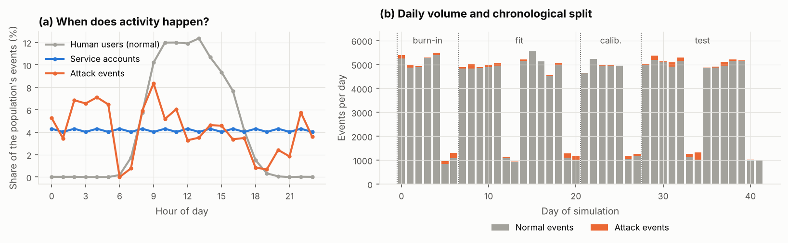
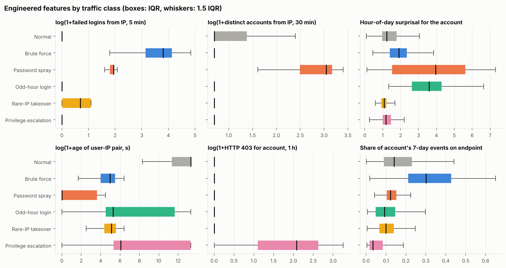
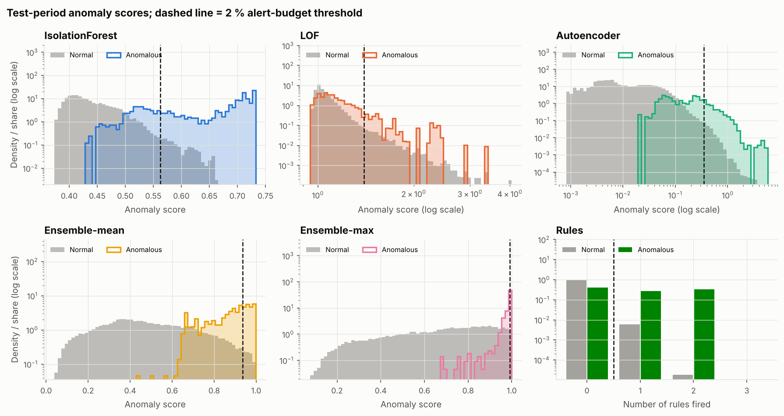
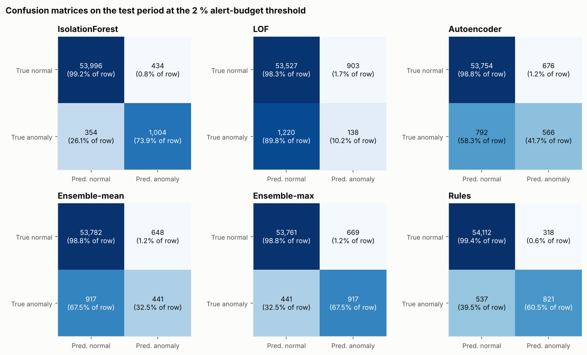
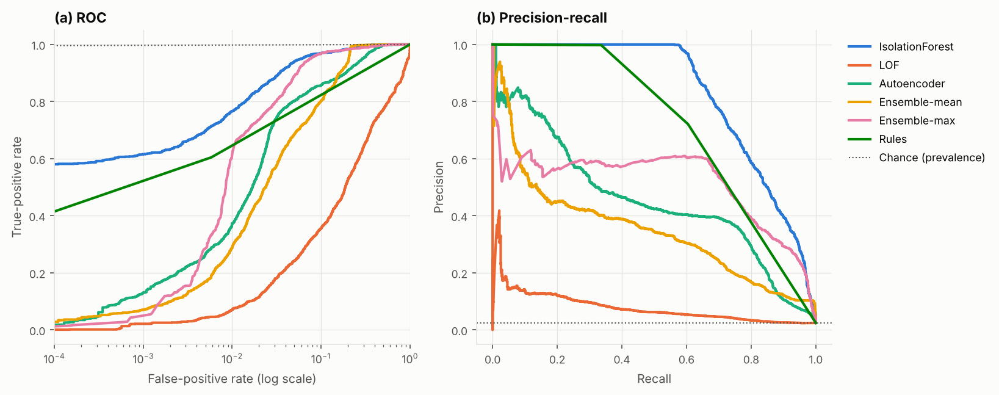
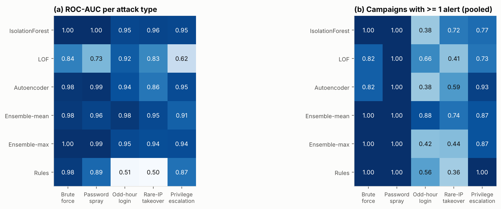
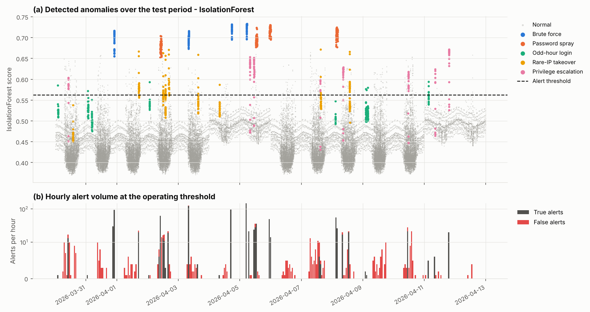
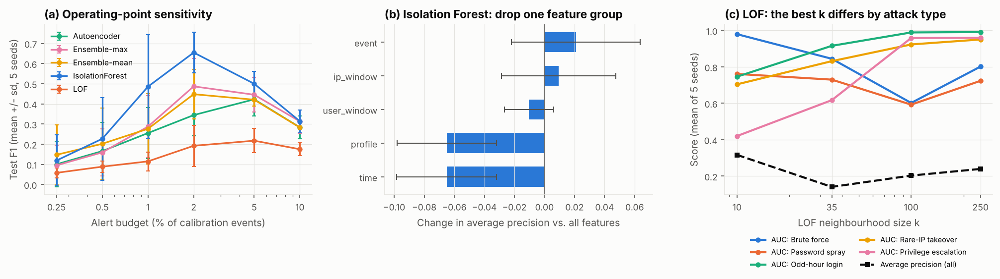

# What Each Detector Can See: Unsupervised Anomaly Detection on Authentication and Access Logs

*Research mini-project — November 2026. Code, data generator, results and
figures are in this repository; every number below is produced by
`python run_pipeline.py`.*

## Abstract

Security operations centres (SOCs) must find credential attacks and insider
misuse in authentication logs where labelled incidents are rare and attacker
behaviour keeps changing. We study fully unsupervised, event-level anomaly
detection on web-application access logs. Because public datasets with
reliable, fine-grained labels for this setting are scarce, we build a
documented generator that simulates six weeks of activity of a 192-account
organisation (human users with personal working hours, IPs and endpoint
habits; 24/7 service accounts; benign confounders such as travel, typos and
late-night work) and injects 92 attack campaigns of five types: brute force,
password spraying, odd-hour use of stolen credentials, account takeover from a
rare IP, and privilege escalation by an insider. From the raw log we derive 24
*causal* features per event (sliding-window rates and failure ratios per
source IP and per account, time-of-day surprisal, and 7-day familiarity
profiles) and compare Isolation Forest, Local Outlier Factor (LOF), an MLP
autoencoder, two rank ensembles and a conventional SIEM rule set. Detectors
are fitted on unlabelled, attack-contaminated weeks, thresholded with a
label-free 2 % alert budget on a calibration week, and evaluated on two
held-out weeks over five independent seeds.
Isolation Forest is the best single detector (ROC-AUC 0.978 ± 0.009,
average precision 0.737 ± 0.102, F1 0.655 ± 0.102 at the operating point)
and catches every brute-force and spraying campaign, but its alert budget is
consumed by these bursts, so odd-hour and rare-IP misuse of valid accounts is
ranked highly yet rarely alerted. A rank-averaging ensemble alerts on 87 % of
all test campaigns, versus 68 % for Isolation Forest and 69 % for the rule
baseline, which is essentially blind to valid-account misuse (ROC-AUC ≈ 0.5).
Ablations show that time-of-day and familiarity features carry most of the
signal for stealthy attacks, and LOF exhibits attack-specific masking that
depends on its neighbourhood size. We discuss implications for SIEM alert
design and the limits of synthetic evaluation.

---

## 1. Introduction

Authentication and access logs are among the first data sources a SIEM
ingests: every login attempt, page view and authorisation failure leaves a
line with a timestamp, an account, a source address, a resource and a status
code. Most attacks on identities are visible in these lines — online password
guessing produces bursts of `401` responses, a stolen password is used at an
hour or from an address its owner never uses, and an insider who probes for
privileges collects `403` responses on administrative paths. In practice,
SOCs detect such patterns with hand-written correlation rules ("ten failed
logins from one IP within five minutes"). Rules are precise for the attacks
they were written for, but they are brittle against variations (a slower
tool, a spray across many accounts) and silent on attacks without a simple
signature, such as the successful use of valid credentials.

Unsupervised anomaly detection promises to complement rules: instead of
describing attacks, it learns what normal activity looks like and flags
deviations. Labels are not needed for training, which fits a domain where
confirmed incidents are rare, expensive to obtain and quickly outdated.
However, the promise comes with well-known caveats: anomalous is not the
same as malicious, the base rate of attacks is tiny, and the choice of
features largely determines what any detector can perceive
(Sommer & Paxson, 2010; Axelsson, 2000).

This project asks a practical question: **given only an access log, which
unsupervised detectors find which kinds of identity attacks, at an alert
volume an analyst can actually review?** Our contributions are:

1. A documented, seeded generator of realistic authentication/access logs
   with five attack families mapped to MITRE ATT&CK techniques, deliberate
   benign confounders, and a hidden event- and campaign-level ground truth.
2. A causal, event-level feature set that combines source-IP and account
   context with stationary 7-day behavioural profiles, suitable for
   streaming deployment.
3. A label-free evaluation protocol (chronological fit / calibration / test
   weeks, contaminated training data, alert-budget thresholds) and a
   comparison of Isolation Forest, LOF, an autoencoder, rank ensembles and a
   SIEM rule baseline across five seeds, including per-attack-type,
   campaign-level, ablation and sensitivity analyses.
4. An analysis of *why* detectors fail: masking of repetitive attack bursts
   in contaminated training data, low-dimensional anomalies hidden among
   many features, and attacks that are only distinguishable from benign
   travel by context the log does not contain.

## 2. Background and Related Work

**Log analysis for security.** Intrusion detection from audit records dates
back to Denning's (1987) model, which profiled subjects' normal behaviour and
flagged statistically unusual actions — the same idea that underlies modern
user and entity behaviour analytics (UEBA). Today, SIEM platforms centralise
logs and evaluate correlation rules; their alert queues are bounded by
analyst capacity, which is why the operating point (alerts per day) matters
as much as ranking quality. Axelsson (2000) showed that, because attacks are
rare, even a small false-positive rate produces an alert stream dominated by
false alarms (the base-rate fallacy); Sommer and Paxson (2010) argued that
machine-learning detectors are often evaluated in ways that hide this and
that a detector's *semantic gap* — what an anomaly actually means
operationally — must be addressed. We take both points as design
constraints: we report precision at a fixed alert budget and analyse what
each detector's alerts correspond to.

**Anomaly detection on system logs.** Much of the log-mining literature
targets *system* logs (e.g. HDFS, BGL) and failures rather than attacks.
Xu et al. (2009) parsed console logs into event-count vectors and applied PCA;
He et al. (2016) benchmarked supervised and unsupervised detectors (PCA,
invariant mining, log clustering) on such data; Loghub (He et al., 2020)
collects public log datasets; DeepLog (Du et al., 2017) models log-key
sequences with an LSTM; Landauer et al. (2023) survey deep-learning
approaches and note that many benchmarks are dominated by a few datasets with
questionable labels. Authentication data for security research include the
LANL comprehensive cyber-security events dataset (Kent, 2015) and the
synthetic CERT insider-threat data (Lindauer et al., 2014). Our setting differs
in granularity (HTTP-level access events with status codes) and in requiring
labels for several distinct attack families, which motivates a transparent
synthetic generator.

**Unsupervised detectors.** *Isolation Forest* (Liu, Ting & Zhou, 2008) builds
random trees on small subsamples; anomalies are isolated after fewer random
splits, giving linear time complexity and robustness to irrelevant scale.
*Local Outlier Factor* (Breunig et al., 2000) compares a point's local
reachability density with that of its *k* nearest neighbours, detecting
points in locally sparse regions. *Autoencoders* (Hinton & Salakhutdinov, 2006)
learn a low-dimensional encoding of the data and flag inputs with high
reconstruction error. Comparative studies (Goldstein & Uchida, 2016; Campos et
al., 2016) find that no detector dominates across datasets and that
evaluation choices strongly affect conclusions. *Outlier ensembles*
(Aggarwal & Sathe, 2015) combine normalised scores — by averaging, which
reduces variance, or by maximisation, which favours detectors with
complementary strengths. Chandola, Banerjee and Kumar (2009) give a general
survey of the field.

**Threat model.** We target five behaviours from MITRE ATT&CK (MITRE, 2024):
password guessing (T1110.001) and password spraying (T1110.003) by external
actors without credentials; use of valid accounts (T1078) by an external
actor at unusual times or from an unusual address; and an insider who probes
administrative functions and escalates privileges. The defender sees only the
access log — no payloads, no threat intelligence, no geolocation.

## 3. Methodology

### 3.1 Synthetic log generation

The generator (`src/generate.py`, parameters in `src/config.py`) simulates a
web application with a login endpoint, nine business endpoints and four
administrative endpoints for 42 days starting on a Monday. The organisation
has 180 human accounts (6 % administrators) and 12 service accounts.

*Human users* have individual working hours (start ~ N(8.4 h, 0.9 h), length
~ N(8.5 h, 1 h)), a log-normal number of sessions per working day, a small
probability of weekend activity, an office-vs-remote probability, and a
Dirichlet-distributed preference over business endpoints. Their source
addresses are one of six shared office NAT addresses, a rotating 20-address
VPN pool (35 % of users) or a personal home address. A session consists of
optional password typos (4 % of logins, 1–3 failures), a successful login, a
log-normal number of page views with exponential think time, and an optional
logout. Administrators direct 18 % of their requests to `/admin/*`.
*Service accounts* log in every 30–120 minutes around the clock from fixed
internal addresses and touch one or two API endpoints.

*Benign confounders* make the problem realistic: forgotten-password streaks
(4–8 failures, sometimes abandoned), business travel (a never-seen IP for a
whole day, 0.6 % of user-days), legitimate late-night sessions (0.4 % of
user-days) and stale admin links (a single 403 for 0.4 % of regular
sessions). They are labelled normal but tagged for error analysis.

*Attack campaigns* (92 per dataset) are placed on uniformly random days:

* **Brute force** (14): a fresh external IP sends 30–150 failed logins to one
  account (40 % administrators) with a campaign-specific tool speed
  (mean gap 0.5–6 s); 30 % eventually succeed and browse quickly.
* **Password spray** (12): one external IP tries 1–2 passwords on 25–70
  accounts, including non-existent names (`admin`, `root`, …), 20–90 s apart.
* **Odd-hour login** (24): stolen credentials are used once between 01:00 and
  04:59 from the VPN pool or the victim's home address; the 8–30 requests are
  skewed towards export and download endpoints.
* **Rare-IP takeover** (24): stolen credentials are used *during the victim's
  working hours* from a never-seen external IP, with 0–2 failed logins and a
  data-heavy session of 10–40 requests.
* **Privilege escalation** (18): a regular user, from a usual address,
  browses normally, then sends 5–25 requests to `/admin/*` that are refused
  (403); in 60 % of campaigns a `PUT /admin/roles` succeeds and admin pages
  are browsed.

Every attacker event is labelled anomalous, including ordinary page views
within hijacked sessions; the ground truth (`labels.csv`) is never read by
the feature or model code.

### 3.2 Feature engineering

Each event is mapped to 24 features computed only from events at or before
its timestamp (Table 1), so the detector could run online and no future
information leaks into the past. Sliding-window counts use half-open windows
(t − w, t] per entity and are computed in one vectorised pass by
binary-searching a composite (entity, time) key; distinct-count windows use a
deque per entity. Counts are `log1p`-compressed.

**Table 1 – Feature groups.**

| Group | Features | Targets |
|---|---|---|
| Event | is_login, is_fail_login, is_forbidden, is_admin_ep, ep_rarity | intrinsic event type |
| Time | hour_sin, hour_cos, is_weekend, user_hour_rarity | odd-hour use |
| Source-IP windows | ip_events_1m, ip_fail_5m, ip_fail_ratio_1h, ip_users_30m | brute force, spraying |
| Account windows | user_fail_10m, user_events_5m, user_forbidden_1h, user_ips_24h, user_gap_log | brute force, probing |
| 7-day profile | ip_events_7d, ip_users_7d, user_events_7d, user_ip_share_7d, user_ip_age, user_ep_share_7d | novelty of IP / endpoint |

`user_hour_rarity` is the smoothed surprisal −log((n_h + 1)/(n + 8)), where
n_h is the number of the account's previous events within ±1 h of the current
hour and n its total history. `user_ip_age` is the time since the
(account, IP) pair was first observed, capped at seven days.

A design iteration is worth reporting. A first version used all-time
cumulative counts for the profile features. Because such counts grow
monotonically, test-period values lay outside the range seen at fit time,
and the distance- and reconstruction-based detectors flagged late events
*en masse*. Replacing them with fixed 7-day windows (plus a one-week burn-in)
made the features stationary and was essential for LOF and the autoencoder.

### 3.3 Detectors

All detectors use scikit-learn (Pedregosa et al., 2011).

* **Isolation Forest (IF)**: 300 trees, subsample size 256 (the value
  recommended by Liu et al., 2008); score = negated `score_samples`.
* **LOF**: novelty mode, k = 35, Euclidean distance on standardised
  features, fitted on a random subsample of 25 000 events (LOF fitting is
  quadratic); tiny Gaussian jitter (σ = 10⁻³) prevents zero reachability
  distances between duplicate events.
* **Autoencoder (AE)**: a scikit-learn `MLPRegressor` with hidden layers
  24-8-24 (ReLU, L2 = 10⁻⁴, Adam, early stopping) trained to reproduce its
  standardised input on up to 30 000 events; score = mean squared
  reconstruction error.
* **Rank ensembles**: each detector's score is converted to its empirical
  percentile on the calibration week; *Ensemble-mean* averages the three
  percentiles, *Ensemble-max* takes their maximum.
* **Rule baseline**: number of fired rules among (R1) ≥ 10 failed logins
  from an IP in 5 min, (R2) ≥ 5 failed logins on an account in 10 min,
  (R3) ≥ 3 HTTP 403 for an account in 1 h, (R4) first successful login of an
  account from an IP, and (R5) ≥ 10 distinct accounts from an IP in 30 min.
  An alert is raised when at least one rule fires.

### 3.4 Evaluation protocol

The 42 days are split chronologically into whole weeks: week 1 is burn-in
(profiles warm up, no fitting), weeks 2–3 are the **fit** period, week 4 the
**calibration** period and weeks 5–6 the **test** period. Attacks occur in
every period, so detectors are trained on contaminated data, as they would
be in production. The operating threshold of every learned detector is the
98th percentile of its calibration-week scores — a *2 % alert budget* chosen
without labels; we vary it from 0.25 % to 10 % in a sensitivity analysis.
On the test weeks we report ROC-AUC, average precision (AP, area under the
precision–recall curve), precision, recall and F1 at the operating threshold,
the alert rate, and the oracle best F1 over all thresholds (an upper bound no
unsupervised deployment can attain). Per attack type we report ROC-AUC
(attack events of that type vs. all normal events), event recall and
*campaign detection*, the fraction of campaigns with at least one alerted
event — the quantity that matters for opening an investigation.
The whole experiment — data, attacks and model seeds — is repeated for five
seeds (0–4); we report mean ± standard deviation, and pool campaigns across
seeds for campaign detection.

## 4. Experiments and Results

All numbers below come from `python run_pipeline.py` (5 seeds, 524 s total on
a 4-core machine) and can be found in `results/summary.md` and the CSV files
in `results/`. Figures show seed 0 unless stated otherwise.

### 4.1 Data

Across the five seeds a dataset contains 173 813 ± 5 434 events, of which
2.13 % ± 0.12 % are anomalous; each has 92 campaigns, 27–35 of which fall
into the two test weeks (154 test campaigns in total, 5 639 anomalous test
events among 290 086). Figure 1 shows the diurnal structure: human activity
is concentrated between 08:00 and 18:00, service accounts are flat over the
day, and attack events are spread across the clock with a night-time excess
due to odd-hour logins. Weekends carry roughly a fifth of a weekday's
volume. Brute force and password spraying produce many events per campaign:
together they account for 50.2 % of the anomalous test events but only
22.7 % of the test campaigns, a fact that shapes the event-level metrics below.

*Figure 1 – (a) Hour-of-day profile of normal human traffic, service
accounts and attack events (seed 0). (b) Daily volume and the
chronological burn-in / fit / calibration / test split.*

Figure 2 confirms that the engineered features separate the attack families
along different axes: brute force stands out in `ip_fail_5m`, spraying in
`ip_users_30m`, odd-hour logins in `user_hour_rarity`, privilege escalation
in `user_forbidden_1h` and in low `user_ep_share_7d`, while rare-IP takeovers
differ from normal traffic mainly by a young (user, IP) pair
(`user_ip_age`) — a signal shared with benign travel.

*Figure 2 – Distribution of six engineered features per traffic class
(seed 0; boxes = inter-quartile range, outliers hidden).*

### 4.2 Overall detection performance

**Table 2 – Test-period results at the 2 % alert budget (mean ± std over 5
seeds). Best value per column in bold.**

| Method | ROC-AUC | Avg. precision | Precision | Recall | F1 | Oracle best F1 | Alert rate | Campaigns detected (pooled) |
|---|---|---|---|---|---|---|---|---|
| Isolation Forest | **0.978 ± 0.009** | **0.737 ± 0.102** | **0.775 ± 0.110** | **0.594 ± 0.162** | **0.655 ± 0.102** | **0.674** | 1.6 % | 105/154 (68.2 %) |
| LOF (k = 35) | 0.810 ± 0.089 | 0.141 ± 0.068 | 0.209 ± 0.104 | 0.184 ± 0.108 | 0.192 ± 0.102 | 0.244 | 1.7 % | 102/154 (66.2 %) |
| Autoencoder | 0.945 ± 0.021 | 0.348 ± 0.104 | 0.387 ± 0.082 | 0.323 ± 0.116 | 0.344 ± 0.103 | 0.439 | 1.7 % | 101/154 (65.6 %) |
| Ensemble-mean | 0.962 ± 0.014 | 0.488 ± 0.136 | 0.534 ± 0.087 | 0.404 ± 0.150 | 0.448 ± 0.124 | 0.492 | 1.5 % | **134/154 (87.0 %)** |
| Ensemble-max | 0.969 ± 0.007 | 0.435 ± 0.097 | 0.541 ± 0.073 | 0.466 ± 0.184 | 0.487 ± 0.138 | 0.548 | 1.7 % | 99/154 (64.3 %) |
| Rules (SIEM baseline) | 0.773 ± 0.054 | 0.462 ± 0.133 | 0.592 ± 0.142 | 0.551 ± 0.107 | 0.570 ± 0.122 | 0.570 | 1.8 % | 107/154 (69.5 %) |

Isolation Forest is the strongest detector at event level on every metric
(ROC-AUC 0.978, AP 0.737, F1 0.655), and its F1 at the label-free threshold
is close to its oracle best F1 (0.674), so the alert-budget rule costs little.
The rule baseline is second by F1 (0.570) but has the lowest ROC-AUC (0.773):
its score has only a few levels and it gives no ranking at all to attacks no
rule describes. The autoencoder ranks well (ROC-AUC 0.945) but is imprecise
in its top scores (AP 0.348), and LOF is the weakest learned detector
(ROC-AUC 0.810 ± 0.089, AP 0.141). Over five seeds the realised test alert
rate (1.5–1.8 %) stays close to the 2 % budget. Variance across seeds is
substantial (IF F1 ranges from 0.486 to 0.748), mostly because the share of
attack events in the calibration week, which sets the threshold, varies from
1.4 % to 3.1 %.

The **campaign-level** column gives a different ranking. Ensemble-mean
alerts on at least one event of 134 of 154 test campaigns (87.0 %), clearly
more than any single detector (≤ 69.5 %), despite a lower event-level F1. We
return to this discrepancy in Section 5.

Figure 3 shows the score distributions. Isolation Forest separates a large
mass of anomalous events (the bursts) at the top of its range; the
autoencoder's anomalous scores overlap more with the normal bulk; LOF's
anomalous and normal distributions largely coincide. Figure 5 gives the
confusion matrices at the operating threshold for seed 0 (for example, IF:
1 004 true positives, 434 false positives, 354 missed anomalous events among
55 788 test events), and Figure 6 the ROC and precision–recall curves: IF
attains a true-positive rate of ≈ 0.58 at a false-positive rate of 10⁻⁴, and
its precision stays at 1.0 up to a recall of ≈ 0.57.

*Figure 3 – Test-period anomaly-score distributions (seed 0), normal (grey)
vs. anomalous (colour); dashed line = operating threshold.*

*Figure 5 – Confusion matrices at the 2 % alert-budget threshold (seed 0).*

*Figure 6 – ROC (log-scaled false-positive rate) and precision–recall
curves on the test period (seed 0).*

### 4.3 What each detector sees: results per attack type

**Table 3 – Per attack type. ROC-AUC (attack events of that type vs. all
normal events) and event recall are means over seeds; campaign detection is
pooled over seeds (n = 22 brute force, 13 spray, 50 odd-hour, 39 rare-IP,
30 privilege-escalation campaigns).**

| Method | Brute force AUC / recall / camp. | Password spray | Odd-hour login | Rare-IP takeover | Privilege escalation |
|---|---|---|---|---|---|
| Isolation Forest | 1.000 / 1.00 / 1.00 | 1.000 / 1.00 / 1.00 | 0.954 / 0.04 / 0.38 | 0.958 / 0.17 / 0.72 | 0.953 / 0.48 / 0.77 |
| LOF | 0.844 / 0.26 / 0.82 | 0.730 / 0.24 / 1.00 | 0.916 / 0.21 / 0.66 | 0.831 / 0.04 / 0.41 | 0.617 / 0.22 / 0.73 |
| Autoencoder | 0.985 / 0.36 / 0.82 | 0.991 / 0.61 / 1.00 | 0.937 / 0.08 / 0.38 | 0.864 / 0.15 / 0.59 | 0.946 / 0.55 / 0.93 |
| Ensemble-mean | 0.980 / 0.57 / 1.00 | 0.961 / 0.43 / 1.00 | **0.982 / 0.30 / 0.88** | 0.950 / 0.23 / **0.74** | 0.906 / 0.40 / 0.87 |
| Ensemble-max | 0.995 / 0.85 / 1.00 | 0.995 / 0.64 / 1.00 | 0.949 / 0.14 / 0.42 | 0.943 / 0.08 / 0.44 | 0.944 / 0.38 / 0.87 |
| Rules | 0.976 / 0.95 / 1.00 | 0.892 / 0.79 / 1.00 | 0.510 / 0.03 / 0.56 | 0.502 / 0.01 / 0.36 | 0.874 / 0.75 / 1.00 |

*Figure 7 – (a) ROC-AUC per attack type (mean over seeds); (b) fraction of
campaigns with at least one alert (pooled over seeds).*

Three patterns stand out (Table 3, Figure 7):

* **Credential-guessing bursts are solved.** Isolation Forest flags every
  brute-force and password-spray event and every such campaign (ROC-AUC
  1.000); the rules are almost as good on brute force (recall 0.95) and
  somewhat weaker on spraying (0.79), because a slow spray crosses the
  per-IP failure and distinct-account thresholds only after several attempts.
* **Valid-account misuse is ranked well but rarely crosses the threshold.**
  For odd-hour and rare-IP logins, Isolation Forest's ROC-AUC is ≈ 0.95, yet
  its event recall at the operating point is only 0.04 and 0.17: these
  events score higher than almost all normal traffic but lower than the
  bursts, which fill the alert budget. The rules are blind to both
  (ROC-AUC ≈ 0.51); the 56 % and 36 % of such campaigns they do catch come
  only from the "first login from a new IP" rule.
* **Rank averaging recovers the stealthy attacks.** Ensemble-mean has the
  best ROC-AUC on odd-hour logins (0.982) and detects 88 % of odd-hour and
  74 % of rare-IP campaigns, because the autoencoder and LOF, which react to
  time-of-day and novelty features, pull these events up, while the average
  pulls the very redundant burst events down. Ensemble-max, by contrast,
  behaves like "Isolation Forest plus extra false alarms": the maximum
  inherits each member's extremes, which are again the bursts.

Privilege escalation is the attack where the rules lead (100 % of campaigns,
recall 0.75), owing to the dedicated "≥ 3 HTTP 403 per hour" rule; the
autoencoder is the best learned detector here (93 % of campaigns).

### 4.4 Detections over time and false-alarm sources

Figure 4 plots every test event of seed 0 by time and Isolation Forest
score. Brute-force and spray campaigns appear as vertical columns far above
the threshold; privilege-escalation sessions straddle it; odd-hour logins and
rare-IP takeovers sit just below it. False alerts (red bars in panel b)
cluster in working hours and are few per hour, while true alerts arrive in
bursts of up to ≈ 100 per hour.

*Figure 4 – (a) Isolation Forest score of every test event over time
(seed 0), colour = ground-truth class, dashed = threshold; (b) hourly number
of true and false alerts (symmetric-log scale).*

**Table 4 – False positives by source of benign traffic (summed over seeds;
rate = share of that source's test events that were alerted).**

| Source (events) | Isolation Forest | LOF | Autoencoder | Ensemble-mean | Rules |
|---|---|---|---|---|---|
| Forgotten-password streaks (289) | 149 (51.6 %) | 10 (3.5 %) | 101 (34.9 %) | 62 (21.5 %) | 108 (37.4 %) |
| Legitimate late-night work (278) | 10 (3.6 %) | 115 (41.4 %) | 41 (14.7 %) | 93 (33.5 %) | 1 (0.4 %) |
| Business travel (1 582) | 29 (1.8 %) | 50 (3.2 %) | 28 (1.8 %) | 56 (3.5 %) | 57 (3.6 %) |
| Service accounts (56 283) | 0 (0.0 %) | 822 (1.5 %) | 0 (0.0 %) | 0 (0.0 %) | 0 (0.0 %) |
| Other human traffic (226 015) | 966 (0.43 %) | 2 774 (1.23 %) | 2 744 (1.21 %) | 1 886 (0.83 %) | 1 892 (0.84 %) |

The confounders were designed to be hard, and they are (Table 4): half of
the events of forgotten-password streaks are flagged by Isolation Forest
(they are small brute-force bursts from a known IP), and legitimate
late-night sessions are the main false-alarm source for LOF and the
ensemble — the very sensitivity that lets them find odd-hour attacks.
Service accounts, whose night-time activity is regular, are never flagged by
Isolation Forest, the autoencoder or the rules. In absolute terms, Isolation
Forest raises ≈ 66 alerts per test day per seed, of which ≈ 16.5 are false.

### 4.5 Ablation and sensitivity

**Feature groups.** Removing one group at a time from Isolation Forest
(Figure 8b) shows that the *time* features (AP 0.737 → 0.672, ROC-AUC
0.978 → 0.936) and the *7-day profile* features (AP → 0.672, ROC-AUC → 0.953)
matter most: without them, odd-hour and rare-IP events lose the signal that
ranks them above normal traffic. Removing the account-window group costs a
little (AP −0.010), while removing the event-intrinsic or source-IP-window
groups slightly *improves* AP (+0.021 and +0.010, within one standard
deviation). These groups are largely redundant with the account windows for
single-account attacks, and extra correlated dimensions dilute Isolation
Forest's random feature choice.

**Alert budget.** F1 of Isolation Forest peaks at the 2 % budget (0.655;
Figure 8a). At 1 % its precision is 0.971 with recall 0.361; at 5 %
recall rises to 0.809 while precision falls to 0.363. The autoencoder peaks
later, at 5 % (F1 0.423), consistent with its anomalies being ranked lower.

**LOF neighbourhood size.** No single k serves all attack types
(Figure 8c): with k = 10, LOF ranks brute force almost perfectly (ROC-AUC
0.980) but privilege escalation *worse than chance* (0.420); with k = 100 the
picture flips (brute force 0.602, privilege escalation 0.959, odd-hour
0.989). Overall AP is non-monotonic (0.317, 0.141, 0.203, 0.240 for
k = 10, 35, 100, 250). Our default k = 35 is, by chance, the worst setting
for AP.

*Figure 8 – (a) Test F1 vs. alert budget (mean ± sd over seeds);
(b) change in Isolation Forest AP when a feature group is removed;
(c) LOF per-type ROC-AUC and overall AP vs. neighbourhood size k.*

**Cost.** Fitting takes ≈ 3 s for Isolation Forest, ≈ 9 s for LOF (25 000
points) and ≈ 17 s for the autoencoder on ≈ 57 000 fit events; feature
extraction for ≈ 170 000 events takes a few seconds.

## 5. Discussion and Limitations

**Event-level and campaign-level views disagree — and the SOC cares about
the latter.** Isolation Forest wins every event-level metric largely because
half of all anomalous events belong to brute-force and spray bursts that it
isolates perfectly. Those bursts consume most of its alert budget: a single
150-attempt brute force produces 150 alerts, all redundant for an analyst.
Ensemble-mean spends the same budget more evenly and touches 87 % of
campaigns instead of 68 %. For operations, this argues for (i) reporting
campaign- or entity-level metrics alongside event metrics, and (ii) alert
aggregation (one alert per source IP or account per time window) before the
budget is applied, which would free capacity for the stealthy attacks that
Isolation Forest already ranks highly (ROC-AUC ≈ 0.95) but does not alert on.

**Contamination and masking.** Detectors were trained on weeks that contain
attacks, as they would be in production. Density- and reconstruction-based
methods suffer from this: attack bursts present at fit time form dense
micro-clusters, so similar test bursts look "normal" to LOF and are
reconstructed well by the autoencoder (brute-force recall 0.26 and 0.36,
although the autoencoder's ROC-AUC on brute force is 0.985). The LOF k-sweep
fits this interpretation: whether an attack family is masked depends on how
k compares with the size of the clusters its events form, so the best k is
attack-specific — in line with Breunig et al.'s (2000) advice to consider a
range of neighbourhood sizes rather than one. Isolation Forest, whose
subsamples of 256 points rarely contain more than a few attack events, is
much less affected.

**Rules and learning are complements.** The rule baseline is precise and
explainable for the behaviours it encodes (brute force, 403 probing), but has
no notion of an account's normal hours or endpoint mix, which leaves
valid-account misuse — arguably the most damaging scenario — almost
invisible (ROC-AUC ≈ 0.5). Conversely, unsupervised detectors miss nothing
of the bursts but need behavioural features to see anything else: the
ablation shows that time-of-day and familiarity profiles carry most of the
signal for the stealthy attacks. The practical recommendation is a layered
design: rules for known patterns, an Isolation Forest or rank ensemble on
behavioural features for the rest, and alert aggregation across both.

**Anomalous is not malicious.** The confounders show the semantic gap
(Sommer & Paxson, 2010): a forgotten password *is* a small brute force, and a
legitimate 23:00 session *is* an odd-hour login. Without additional context
(MFA results, helpdesk tickets, travel calendars, geolocation), no log-only
detector can separate them, and their false-alarm rates in Table 4 should
be read as a floor for real deployments.

**Limitations and threats to validity.**

* *Synthetic data.* The generator encodes our assumptions about user
  behaviour and attackers. Real logs have heavier tails, seasonality,
  software changes, NAT and proxy effects, and attackers who adapt. The
  absolute numbers (e.g. F1 = 0.655) should not be expected to transfer; the
  relative strengths and blind spots of the methods are the transferable
  result. Validating on real data, e.g. the LANL authentication logs, is the
  natural next step.
* *Generator–feature alignment.* The same authors designed the attacks and
  the features, so features may be better aligned with the injected attacks
  than they would be with unknown ones. We mitigated this by including benign
  confounders and an attack (rare-IP takeover during working hours) that is
  intentionally hard to separate from travel, but the risk remains.
* *Labelling choice.* All attacker events, including ordinary page views in
  hijacked sessions, are labelled anomalous. This makes event recall
  conservative; campaign detection is reported to compensate.
* *Small campaign counts and variance.* There are only 13–50 test campaigns
  per type pooled over five seeds, and seed-to-seed F1 standard deviations
  are ≈ 0.10–0.14. Differences of a few points between methods are not
  significant; the large gaps (e.g. ensemble-mean vs. IF on odd-hour
  campaigns, 0.88 vs. 0.38) are.
* *Untuned models.* Hyperparameters were set a priori (library defaults or
  literature values) rather than tuned on labels, as an unsupervised
  deployment would require; the k-sweep shows how much this can matter.
* *Scope.* We do not model distributed attacks from many IPs, attacker
  mimicry of the victim's habits, or sequence models such as DeepLog; the
  autoencoder is a small MLP rather than a deep architecture.

## 6. Conclusion

We built an end-to-end, reproducible pipeline for unsupervised detection of
identity attacks in access logs: a documented log and attack generator, 24
causal event-level features combining source-IP and account context with
stationary 7-day profiles, four unsupervised detectors plus a rule baseline,
and a label-free fit / calibrate / test protocol. Isolation Forest is the
best single detector (ROC-AUC 0.978 ± 0.009, AP 0.737 ± 0.102, F1 0.655 ±
0.102 at a 2 % alert budget) and detects every brute-force and spray
campaign. However, its alerts are dominated by these bursts: odd-hour and
rare-IP misuse of valid accounts is ranked highly but seldom alerted. A
rank-averaging ensemble of Isolation Forest, LOF and an autoencoder trades
event-level F1 (0.448) for markedly broader coverage, alerting on 87 % of
all campaigns versus 68 % for Isolation Forest and 69 % for SIEM rules,
which are blind to valid-account misuse. Time-of-day and familiarity
features are the most important inputs, and density-based methods are
fragile when attacks contaminate the training data. Future work should
evaluate alert aggregation before thresholding, sequence-aware models of
sessions, and validation on real authentication logs.

## References

- Aggarwal, C. C., & Sathe, S. (2015). Theoretical foundations and algorithms for outlier ensembles. *ACM SIGKDD Explorations Newsletter*, 17(1), 24–47.
- Axelsson, S. (2000). The base-rate fallacy and the difficulty of intrusion detection. *ACM Transactions on Information and System Security*, 3(3), 186–205.
- Breunig, M. M., Kriegel, H.-P., Ng, R. T., & Sander, J. (2000). LOF: Identifying density-based local outliers. In *Proceedings of the 2000 ACM SIGMOD International Conference on Management of Data* (pp. 93–104).
- Campos, G. O., Zimek, A., Sander, J., Campello, R. J. G. B., Micenková, B., Schubert, E., Assent, I., & Houle, M. E. (2016). On the evaluation of unsupervised outlier detection: Measures, datasets, and an empirical study. *Data Mining and Knowledge Discovery*, 30(4), 891–927.
- Chandola, V., Banerjee, A., & Kumar, V. (2009). Anomaly detection: A survey. *ACM Computing Surveys*, 41(3), Article 15.
- Denning, D. E. (1987). An intrusion-detection model. *IEEE Transactions on Software Engineering*, SE-13(2), 222–232.
- Du, M., Li, F., Zheng, G., & Srikumar, V. (2017). DeepLog: Anomaly detection and diagnosis from system logs through deep learning. In *Proceedings of the 2017 ACM SIGSAC Conference on Computer and Communications Security (CCS)* (pp. 1285–1298).
- Goldstein, M., & Uchida, S. (2016). A comparative evaluation of unsupervised anomaly detection algorithms for multivariate data. *PLoS ONE*, 11(4), e0152173.
- He, S., Zhu, J., He, P., & Lyu, M. R. (2016). Experience report: System log analysis for anomaly detection. In *Proceedings of the 27th IEEE International Symposium on Software Reliability Engineering (ISSRE)* (pp. 207–218).
- He, S., Zhu, J., He, P., & Lyu, M. R. (2020). Loghub: A large collection of system log datasets towards automated log analytics. *arXiv preprint* arXiv:2008.06448.
- Hinton, G. E., & Salakhutdinov, R. R. (2006). Reducing the dimensionality of data with neural networks. *Science*, 313(5786), 504–507.
- Kent, A. D. (2015). *Comprehensive, Multi-Source Cyber-Security Events*. Los Alamos National Laboratory. https://doi.org/10.17021/1179829
- Landauer, M., Onder, S., Skopik, F., & Wurzenberger, M. (2023). Deep learning for anomaly detection in log data: A survey. *Machine Learning with Applications*, 12, 100470.
- Lindauer, B., Glasser, J., Rosen, M., & Wallnau, K. (2014). Generating test data for insider threat detectors. *Journal of Wireless Mobile Networks, Ubiquitous Computing, and Dependable Applications*, 5(2), 80–94.
- Liu, F. T., Ting, K. M., & Zhou, Z.-H. (2008). Isolation forest. In *Proceedings of the 8th IEEE International Conference on Data Mining (ICDM)* (pp. 413–422).
- MITRE (2024). *ATT&CK for Enterprise*: T1110 Brute Force (.001 Password Guessing, .003 Password Spraying), T1078 Valid Accounts. https://attack.mitre.org/
- Pedregosa, F., Varoquaux, G., Gramfort, A., et al. (2011). Scikit-learn: Machine learning in Python. *Journal of Machine Learning Research*, 12, 2825–2830.
- Sommer, R., & Paxson, V. (2010). Outside the closed world: On using machine learning for network intrusion detection. In *Proceedings of the 2010 IEEE Symposium on Security and Privacy* (pp. 305–316).
- Xu, W., Huang, L., Fox, A., Patterson, D., & Jordan, M. I. (2009). Detecting large-scale system problems by mining console logs. In *Proceedings of the ACM SIGOPS 22nd Symposium on Operating Systems Principles (SOSP)* (pp. 117–132).
